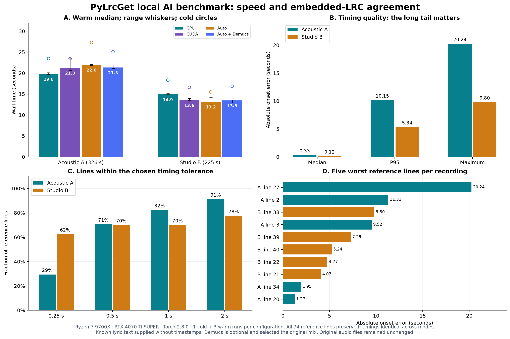

# AI timing and embedded-ground-truth benchmark

Local date: **2026-11-13**, Europe/Bucharest. Machine: Ryzen 7 9700X (8 cores,
16 logical processors), RTX 4070 Ti SUPER (16 GB), driver 610.88, Windows,
Python 3.13.15, Torch 2.8.0+cu128 with 8 CPU threads, WhisperX 3.8.6.

The result is functional but has significant timing outliers. Preserving every
lyric line does not establish accurate synchronization.



[Exportable SVG](assets/ai-benchmarks/2026-11-13.svg) and
[anonymized measurements](benchmarks/ai-2026-11-13.json).

The [follow-up comparison](AI_OPTIMIZATION_EXPERIMENTS.md) measures WhisperX
against lyrics-aligner directly, tests optimizations independently and records
the faster implementation now retained in the application. The timings below
remain the original baseline.

## Method

Two user-selected FLAC recordings had existing embedded synchronized lyrics:
Acoustic A, 326.08 seconds and 34 lines; Studio B, 224.89 seconds and 40 lines.
The originals were only read. Each was copied into an isolated temporary directory.
Input SHA-256, size and modification time were checked before and after both runs.
All originals remained unchanged.

The AI received the lyric text with the reference timestamps removed. Ground-truth
timestamps were used only after inference. The production persistent runtime and
English phonetic backend performed all alignments; inference was not mocked.
No manual timing hints were supplied to these benchmark jobs.

For each recording and configuration, a new process ran one cold warm-up and three
measured warm jobs: **8 configurations, 32 successful executions** in total. Jobs
ran sequentially. Cold time includes process startup and model initialization;
warm time uses the same loaded model. Model files were already cached, so download
time is excluded. Ordinary desktop background activity was not disabled. The warm
p95 is descriptive of three samples, not a production latency guarantee.

Lines are paired by normalized text and occurrence number. The parser retains
output order, so sorting cannot hide backward timestamps. Coverage, missing/changed
lines, signed bias, absolute error, tolerance hit rates, duplicate/backward timestamps
and values outside the audio duration are recorded. All runs used the same AI
source fingerprint; the JSON records it for later comparison. The checkpoint and
phoneme table matched the verified pinned backend archive. Python backend files
also matched after normalizing Windows line endings; their normalized hashes and
the checkpoint hash are recorded with the measurements.

## Performance

All values below are seconds. Auto selected CUDA on this machine.

| Recording | Configuration | Cold | Warm median | Warm p95 | Real-time factor |
| --- | --- | ---: | ---: | ---: | ---: |
| Acoustic A | CPU | 23.46 | 19.81 | 20.05 | 0.061 |
| Acoustic A | CUDA | 23.45 | 21.27 | 23.36 | 0.065 |
| Acoustic A | Auto | 27.31 | 22.00 | 22.06 | 0.067 |
| Acoustic A | Auto, Demucs enabled | 25.10 | 21.35 | 21.90 | 0.065 |
| Studio B | CPU | 18.32 | 14.92 | 15.17 | 0.066 |
| Studio B | CUDA | 16.60 | 13.55 | 13.90 | 0.060 |
| Studio B | Auto | 15.49 | 13.18 | 14.04 | 0.059 |
| Studio B | Auto, Demucs enabled | 16.86 | 13.48 | 13.61 | 0.060 |

Real-time factor is wall time divided by recording duration; lower is faster.
CPU was slightly faster on Acoustic A; CUDA/Auto were slightly faster on Studio B.
These two recordings do not support a general claim that GPU is always faster.

The optional Demucs configuration selected the original mix in every measured
job, so it did not improve the returned timestamps on these samples. Separately,
real CPU and CUDA vocal separation were exercised on an eight-second music excerpt;
see [functional validation](AI_VALIDATION.md). Enabling a candidate does not force
it to replace an already high-scoring mix.

## Agreement with embedded timing

CPU, CUDA, Auto and Auto with Demucs returned the same measured timing quality
on every repetition. All 74 reference lines were preserved, with no missing/extra
lines, backward/duplicate timestamps or timestamps outside the recording.

| Recording | Median error | P95 error | Maximum error | Within 0.5 s | Within 1 s | Within 2 s |
| --- | ---: | ---: | ---: | ---: | ---: | ---: |
| Acoustic A | 0.33 s | 10.15 s | 20.24 s | 70.6% | 82.4% | 91.2% |
| Studio B | 0.12 s | 5.34 s | 9.80 s | 70.0% | 70.0% | 77.5% |

The small median hides the tail. Acoustic A's largest disagreement is line 27:
280.88 s in the reference versus 260.64 s in the generated result. Studio B's
largest is line 38: 203.98 s versus 213.78 s. Local JSON reports list the five worst
line numbers for every run without publishing lyric text.

AI output should remain a draft for manual review. No model tuning or production
accuracy improvement is claimed by this benchmark. The reference is the user's
embedded LRC; it was not independently reannotated against the waveform.

## Reproduce safely

Use Python with the application's core dependencies. Select an installed AI runtime:

```powershell
python tools/benchmark_ai_embedded.py `
  --audio "C:\ReadOnly\acoustic.flac" `
  --audio "C:\ReadOnly\studio.flac" `
  --runtime "$env:LOCALAPPDATA\PyLrcGet\ai-runtime\Scripts\python.exe" `
  --output-root "$env:TEMP\pylrcget-benchmarks" `
  --devices cpu cuda auto --demucs off --warmups 1 --runs 3
```

Repeat with `--devices auto --demucs on` for the optional candidate. Each execution
creates a new run directory, local audio copies, JSON and Markdown. The benchmark
refuses output inside an input directory. Raw reports include source paths and
must stay outside Git; the published JSON omits private paths, audio and lyric text.
The tool currently benchmarks English lyrics with embedded LRC text tags.

## Remaining verification gaps

- Broader artist/genre/language ground truth, including lyric-free introductions,
  long instrumental gaps and repeated choruses. This sample has only two recordings.
- A curated, redistributable singing fixture set and an accuracy regression gate in
  CI. Existing CI checks dependencies and code behavior; it does not establish
  musical timing accuracy.
- Linux, macOS/MPS, other GPU generations and real AI decoding for input formats
  beyond the FLAC/WAV fixtures used here.
- A complete packaged-installer GUI automation pass using isolated application
  data, plus installation cancellation/network-loss scenarios. The package build,
  bundled runtime source, real setup commands and synchronization cancellation
  were verified separately.
- Longer runs with more samples for reliable latency tails, memory growth and
  many-track stress. Three warm repetitions are a local baseline.
