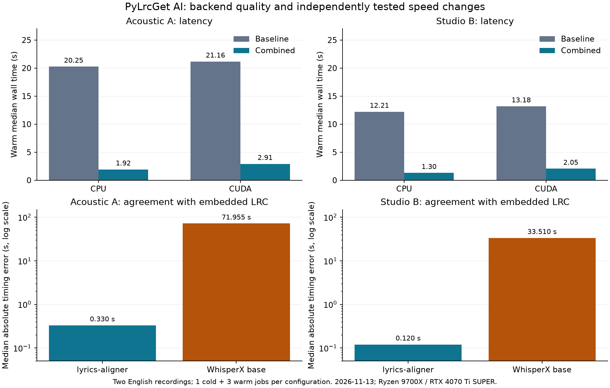

# AI backend comparison and independent optimization experiments

Measured locally on 2026-11-13, using the same machine, pinned AI packages and
recordings as [the original benchmark](AI_BENCHMARKS.md). The original benchmark
compared lyrics-aligner device modes; it did not establish a WhisperX winner.
This follow-up explicitly forces each backend through the production runtime.

## Scope and method

Acoustic A is 326.08 seconds with 34 embedded synchronized lines. Studio B is
224.89 seconds with 40 lines. Both are English recordings from the same artist.
The user-provided library is strictly read-only. All inference and separation
use local temporary copies. Reference timestamps never enter the AI requests.
They are used only to score results after inference; no manual anchors are used.

Every full pipeline configuration starts a fresh persistent process, performs
one cold warm-up, and then three measured warm runs. CPU and CUDA jobs execute
sequentially. Models are cached; download time is excluded. Median wall times
are descriptive, without statistical significance claims from three samples.
The JSON preserves individual timings, cold timings, source hashes and quality.

Each candidate starts from the same frozen source tree at `7ca33ee`. Independent
variants change only the stated operation. The combined variant is tested after
individual candidates. Kernel experiments reuse the same real neural scores or
word predictions, so postprocessing comparisons cannot be confounded by a new
transcription. Three batches of 100 calls measure word-to-line matching; DTW
kernels use one warm-up and three measured calls. Profiling is separate from
wall-time benchmark runs.

WhisperX here means the application's actual `base` pipeline: ASR, forced
alignment of the transcription, and matching the supplied lyrics to those word
timestamps. This is not a general comparison of all Whisper models or every
possible known-text forced-alignment method. Disabling the English backend only
in the child process forces this route without changing user settings.

## Measurements

80 full pipeline executions succeeded: five independent configuration families,
two recordings, two devices and four calls per configuration (one cold + three warm).
All 74 lines were preserved in every job. Original library files and local inputs
passed integrity checks. Eight additional production-runtime jobs compare the full
LRC output against cached baseline predictions; all eight have identical SHA-256.

| Recording | Pipeline | CPU warm s | CUDA warm s | Median error s | P95 error s | Within 1 s |
| --- | --- | ---: | ---: | ---: | ---: | ---: |
| Acoustic A | lyrics-aligner baseline | 20.25 | 21.16 | 0.330 | 10.147 | 82.4% |
| Acoustic A | WhisperX base | 10.30 | 2.06 | 71.955 | 125.118 | 0.0% |
| Studio B | lyrics-aligner baseline | 12.21 | 13.18 | 0.120 | 5.343 | 70.0% |
| Studio B | WhisperX base | 13.98 | 2.70 | 33.510 | 57.436 | 0.0% |

lyrics-aligner is substantially more accurate on both recordings. WhisperX has lower baseline CUDA latency, but none of its 74 lines are within one second of the reference. CPU
and CUDA return the same timing quality within each backend.

### Independent speed changes

| Recording / device | Baseline s | Model DTW only s | Final DTW only s | Combined s | Combined speedup |
| --- | ---: | ---: | ---: | ---: | ---: |
| Acoustic A / CPU | 20.25 | 5.69 | 19.64 | 1.92 | 10.5x |
| Acoustic A / CUDA | 21.16 | 3.39 | 22.44 | 2.91 | 7.3x |
| Studio B / CPU | 12.21 | 3.97 | 12.49 | 1.30 | 9.4x |
| Studio B / CUDA | 13.18 | 2.43 | 13.88 | 2.05 | 6.4x |

Combined includes the model DTW, final DTW and exact-word changes. Every measured
run of these variants has exactly the baseline's timing metrics, including the
same outlier line numbers and timestamps. These are speed improvements, with no
accuracy gain claimed. The largest residual errors remain 20.24 s and 9.80 s.

| Isolated operation | Acoustic A | Studio B | Decision |
| --- | --- | --- | --- |
| Final DTW, upstream CPU | 3920.4 ms | 2378.2 ms | Identical final path |
| Final DTW, original CUDA | 691.3 ms | 468.8 ms | Identical final path |
| Final DTW, NumPy rows | 171.4 ms | 87.7 ms | Identical final path |
| Word matching, original | 6.851 ms | 5.974 ms | Identical output |
| Word matching, exact fast path | 0.291 ms | 0.288 ms | Identical output |

The word fast path saves approximately six milliseconds per recording, not
seconds. Final-DTW-only did not show a consistent full-pipeline gain in this
run; the cause of that timing variation was not isolated. Its exact path parity,
smaller kernel time and lower combined latency versus model-DTW-only support
retaining it. The measurements do not establish additive speedups.

The internal model DTW also passed exact accumulated-score equality on both real
score matrices (including the original float32 initialization of 200000). Its
single direct baseline calls took 18.86 and 11.70 s; candidate warm medians were
0.084 and 0.052 s. These stage timings are separate from full pipeline medians.

### Accuracy experiments and rejected candidates

- Disabling repeated-block repair leaves Acoustic A unchanged, but worsens Studio
  B's p95 error from 5.34 to 7.42 s and maximum error from 9.80 to 14.53 s. Rejected.
- Silence thresholds 0, 15 and 60 versus the default 30 return the same timing
  metrics on both recordings. No accuracy improvement; default unchanged.
- Vectorized silence masking produces exactly the same scores but saves less than
  a millisecond per recording in steady state. Not retained as a material speed change.

### Forced vocal separation

The production quality gate previously skipped separation on both mixes. This
experiment explicitly aligns real full-length Demucs vocal stems, regardless of
that gate. It uses the independently verified model-DTW speed change, with the
same alignment arithmetic. Three complete separation/alignment trials per song
use seeds 123, 124 and 125. Separation reloads the Demucs model as production does;
these timings are direct backend calls, separate from the persistent-client table.

| Recording | Median total s | Median separation s | Median error s (three trials) | P95 error s (three trials) |
| --- | ---: | ---: | --- | --- |
| Acoustic A | 7.82 | 4.76 | 0.330, 0.310, 0.310 | 5.530, 5.530, 5.530 |
| Studio B | 5.46 | 3.35 | 0.120, 0.110, 0.110 | 7.035, 7.139, 7.035 |

Vocal separation improves Acoustic A's p95 error (10.15 to 5.53 s), but worsens
Studio B's p95 (5.34 to approximately 7.1 s). Individual lines improve and regress.
No automatic preference or default change is justified by this sample. The
existing structural heuristic cannot substitute for ground-truth timing accuracy.

[Anonymized individual measurements](benchmarks/ai-optimizations-2026-11-13.json)
and [exportable SVG](assets/ai-benchmarks/2026-11-13-optimizations.svg).

## Selection and limits

The embedded LRC is the reference supplied by the user, not an independently
reannotated waveform. These two English songs cannot establish results for other
artists, genres, languages, hardware or recordings. Preserving all lines is not
proof that their timestamps are correct. Large outliers still require review.

Speed changes preserve the model's original float32 recurrence, the final DTW's
float64 recurrence and its tie-breaking, and the earliest best word match within
the existing eight-word search window. Unsupported model modes, dtypes and
gradient-enabled calls retain the upstream implementation. Upstream cache files
are never edited. AI results remain drafts.

## Reproduce

Run `tools/benchmark_ai_embedded.py` with the same two inputs, runtime and run
counts documented in [the original benchmark](AI_BENCHMARKS.md), adding
`--backend lyrics-aligner` or `--backend whisperx`. `--whisper-model base`
selects the ASR model explicitly. `--source-root` selects a frozen source tree
containing `ui/workers/ai`; the report hashes that exact tree and rejects a runtime
that imports AI code from outside it. Keep all outputs
outside input directories. The backend override exists only in the child
process; the host environment and application settings are unchanged.

To isolate a code candidate, construct a temporary baseline source snapshot
containing only that candidate's AI code change. The JSON lists focused commits
`c60593c` (model DTW), `e1d750d` (final DTW) and `0943eee` (word matching), plus
source fingerprints. Changelog changes are not part of a runtime snapshot. Do not
compare progressively stacked changes as if they were independent. The published
JSON omits paths, lyric text, audio and raw neural matrices. Raw local reports
and copied audio remain outside Git.

## Validation

- General suite in the core environment: 892 passed, 16 optional tensor tests
  skipped, 5 subtests passed. The core environment intentionally has no Torch.
- AI suite with real Torch and CUDA available: 212 passed, including the optional
  tensor cases. An existing optional TorchCodec decoding warning remains; all
  real audio jobs use the application's working audio-loading paths.
- Ruff and whitespace checks passed. The real benchmark CLI also rejected an
  installed package shadowing the selected baseline source snapshot.
- All five runtime source imports were checked against their selected trees;
  the production English module matches the measured combined variant exactly.
- Original MOS audio SHA-256, byte size and modification time remain unchanged.
